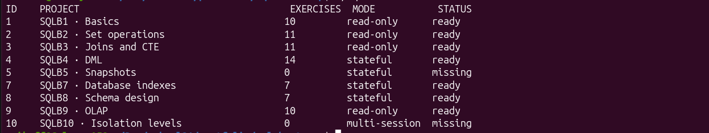
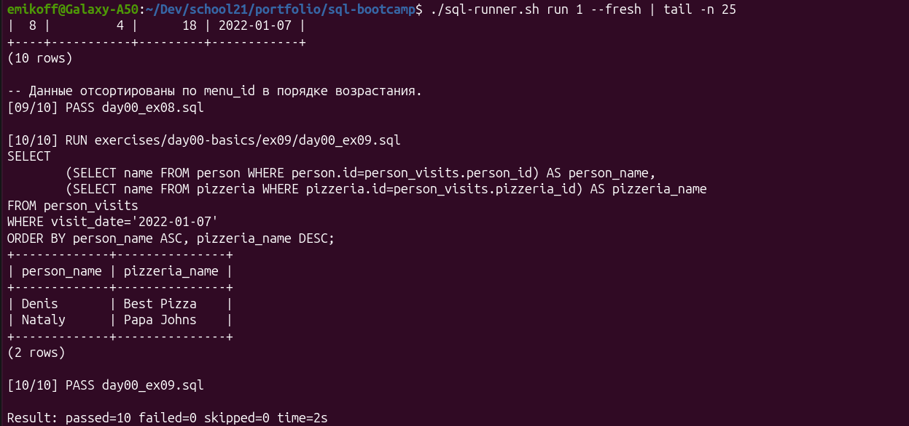
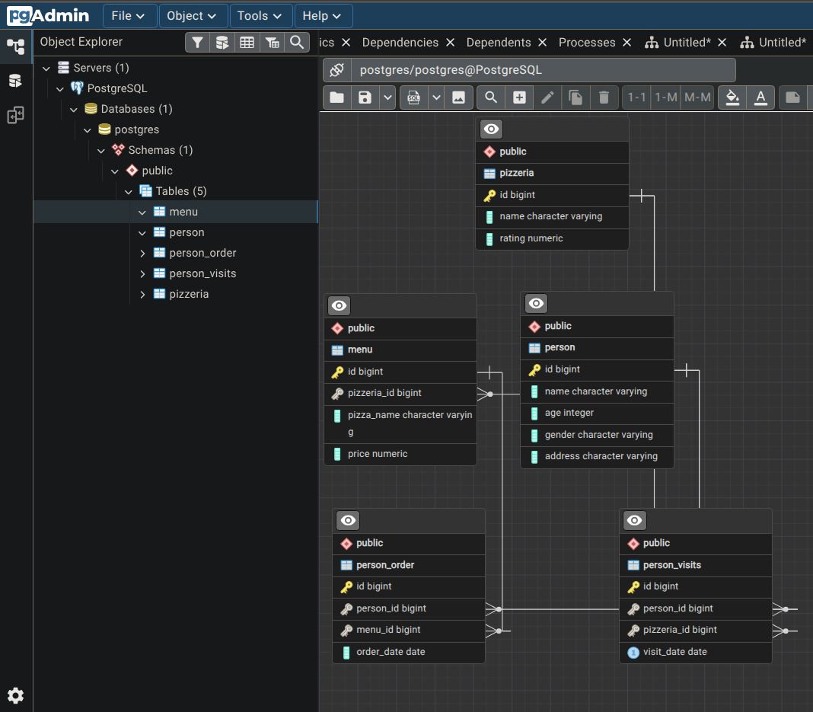
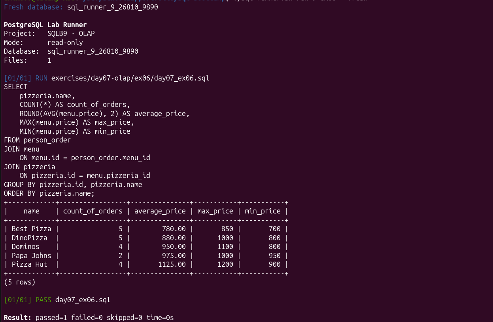

# PostgreSQL Query Lab

Практическая лаборатория PostgreSQL: 70 SQL-решений от базовых выборок и объединения наборов до DML, индексов, ограничений и аналитических запросов. Проект содержит воспроизводимое Docker-окружение и Bash CLI для запуска одного упражнения или целого тематического блока.

## Что реализовано

- запросы `SELECT`, фильтрация, сортировка и преобразование данных;
- `UNION`, `INTERSECT`, `EXCEPT`, подзапросы и различные виды `JOIN`;
- CTE и генерация последовательностей дат;
- `INSERT`, `UPDATE`, `DELETE` и связанные изменения данных;
- обычные, уникальные, частичные и многоколоночные индексы;
- исследование планов через `EXPLAIN ANALYZE`;
- таблицы, ограничения целостности и sequence;
- агрегирование, группировка и OLAP-запросы;
- универсальный runner с обнаружением SQL-ошибок и временными базами.

## Содержание



| Раздел | Тема | Решений | Режим | Отчёт |
| --- | --- | ---: | --- | --- |
| Day 00 | Основы SQL | 10 | read-only | [Открыть](docs/day00-basics.md) |
| Day 01 | Операции над множествами | 11 | read-only | [Открыть](docs/day01-set-operations.md) |
| Day 02 | JOIN и CTE | 11 | read-only | [Открыть](docs/day02-joins.md) |
| Day 03 | DML | 14 | stateful | [Открыть](docs/day03-dml.md) |
| Day 04 | Snapshots | — | отсутствует в копии | — |
| Day 05 | Индексы и планы выполнения | 7 | stateful | [Открыть](docs/day05-indexes.md) |
| Day 06 | Проектирование схемы | 7 | stateful | [Открыть](docs/day06-schema-design.md) |
| Day 07 | Агрегация и OLAP | 10 | read-only | [Открыть](docs/day07-olap.md) |
| Day 08 | Транзакции и изоляция | — | запланировано | — |

Всего: **70 SQL-решений**.

## Быстрый запуск

Требуются Docker и Docker Compose.

```bash
cp .env.example .env
docker compose up -d
./sql-runner.sh status
./sql-runner.sh list
```

Запустить весь read-only раздел или одно упражнение:

```bash
./sql-runner.sh run 2
./sql-runner.sh run SQLB2 ex03
```

Stateful-разделы безопаснее запускать в одноразовой базе:

```bash
./sql-runner.sh run 4 --fresh
./sql-runner.sh run 8 ex06 --fresh
```

`--fresh` создаёт временную базу, загружает [`database/init.sql`](database/init.sql), выполняет запросы и удаляет базу после завершения. Подробнее: [документация runner](RUNNER.md).



## Структура

```text
exercises/       авторские SQL-решения по темам
database/        схема и демонстрационные данные
docs/            тематические отчёты
tests/           тесты CLI без подключения к реальной БД
compose.yml      PostgreSQL 16 и pgAdmin
sql-runner.sh    единая точка запуска упражнений
```

Архитектура и режимы выполнения описаны в [`docs/architecture.md`](docs/architecture.md). Результаты полного прогона собраны в [`docs/verification.md`](docs/verification.md).

## Демонстрация

Схема учебной базы в pgAdmin:



Пример аналитического запроса с агрегированными метриками:



## Избранные примеры

- [CTE и поиск отсутствующих дат](exercises/day02-joins/ex03/day02_ex03.sql);
- [сравнение плана с индексом и без него](docs/performance.md);
- [ограничения целостности для скидок](exercises/day06-schema-design/ex04/day06_ex04.sql);
- [агрегированные показатели ресторанов](exercises/day07-olap/ex06/day07_ex06.sql).

## Проверка

Тесты runner используют mock Docker и не изменяют реальную базу:

```bash
./tests/test-runner.sh
shellcheck sql-runner.sh tests/test-runner.sh
```

Runner проверяет исполнимость SQL и останавливается при первой ошибке PostgreSQL благодаря `ON_ERROR_STOP=1`. Дополнительная ручная ревизия проверяет алиасы, сортировку, обязательные и запрещённые SQL-конструкции по исходным условиям. Подробности — в [отчёте о проверке](docs/verification.md).

## Ограничения

- Day 04 отсутствует в текущей коллекции.
- Day 08 требует сценариев с двумя параллельными сессиями и пока не автоматизирован.
- Stateful-разделы зависят от порядка упражнений; при выборе одного упражнения с `--fresh` runner выполняет необходимые предыдущие файлы.
- Инициализационная схема предназначена для локальной учебной среды, а не для production.
