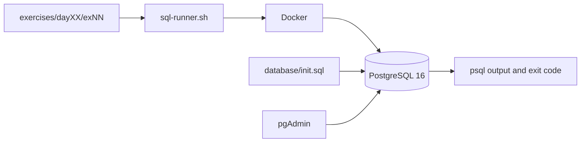
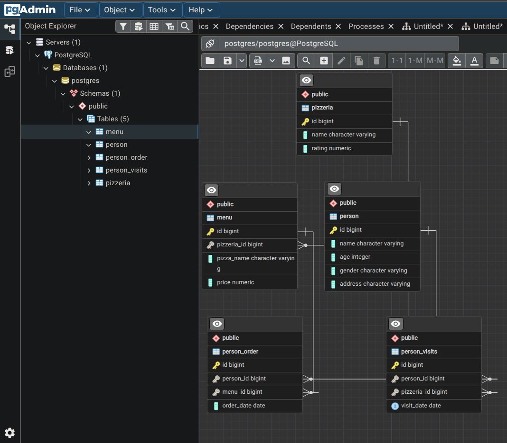

# Архитектура проекта

[← README](../README.md)

База содержит пять связанных таблиц: `person`, `pizzeria`, `menu`, `person_order` и `person_visits`. Внешние ключи связывают пользователей и рестораны с посещениями, меню и заказами.

## Режимы выполнения

`read-only` выполняет выбранные запросы в существующей базе. `stateful` предупреждает перед изменением постоянной базы. Режим `--fresh` создаёт временную базу и подходит для воспроизводимой проверки DML, индексов и изменений схемы.

Для выбранного stateful-упражнения runner выполняет файлы от `ex00` до цели: поздние упражнения могут зависеть от таблиц, данных или индексов, созданных ранее.

## Обработка ошибок

Каждый файл передаётся `psql` с `ON_ERROR_STOP=1`. При первой ошибке выполнение прекращается, runner возвращает ненулевой код и показывает количество успешных, ошибочных и пропущенных файлов.
