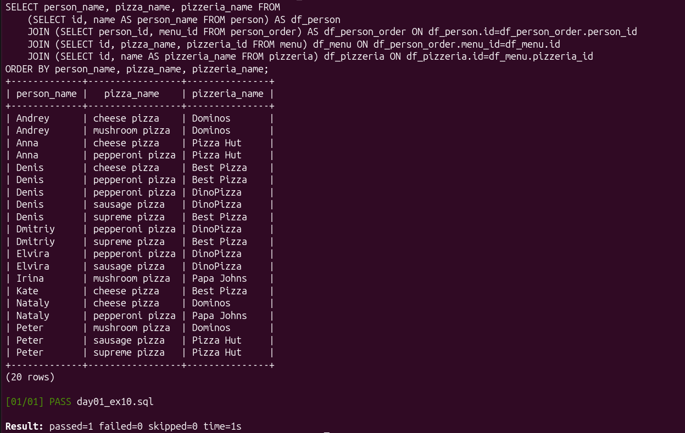

# Day 01. Операции над множествами

[← Day 00](day00-basics.md) · [README](../README.md) · [Day 02 →](day02-joins.md)

Одиннадцать решений посвящены объединению наборов, сохранению и устранению дубликатов, декартову произведению, подзапросам и сравнению `IN` с `EXISTS`.

Ключевые навыки: `UNION`, `UNION ALL`, `INTERSECT`, `EXCEPT`, подзапросы и соединение нескольких сущностей.

Показательный пример: [`ex10/day01_ex10.sql`](../exercises/day01-set-operations/ex10/day01_ex10.sql) связывает людей, заказы, меню и пиццерии в одном результате.

