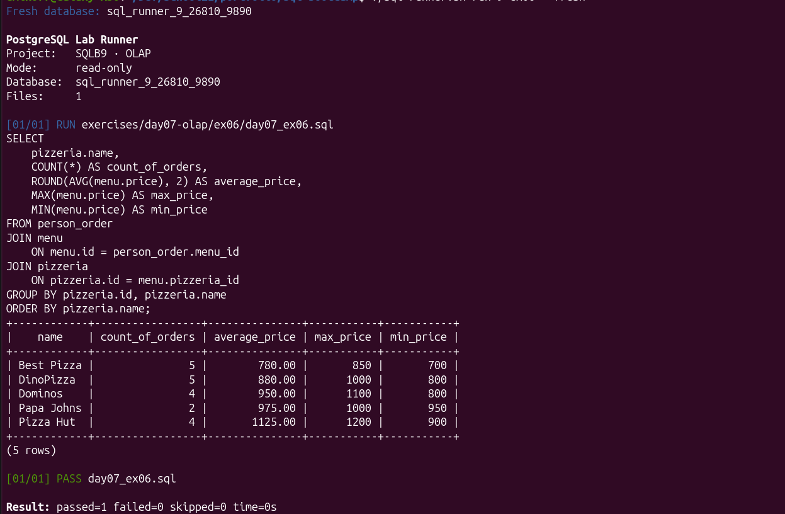

# Day 07. Агрегация и OLAP

[← Day 06](day06-schema-design.md) · [README](../README.md)

Десять запросов посвящены агрегатам, группировке, фильтрации групп и вычислению статистики по ресторанам и заказам.

Ключевые навыки: `COUNT`, `AVG`, `MIN`, `MAX`, `ROUND`, `GROUP BY`, `HAVING` и явное преобразование типов.

Показательный пример: [`ex06/day07_ex06.sql`](../exercises/day07-olap/ex06/day07_ex06.sql) вычисляет количество заказов, среднюю, минимальную и максимальную цену для каждой пиццерии.

